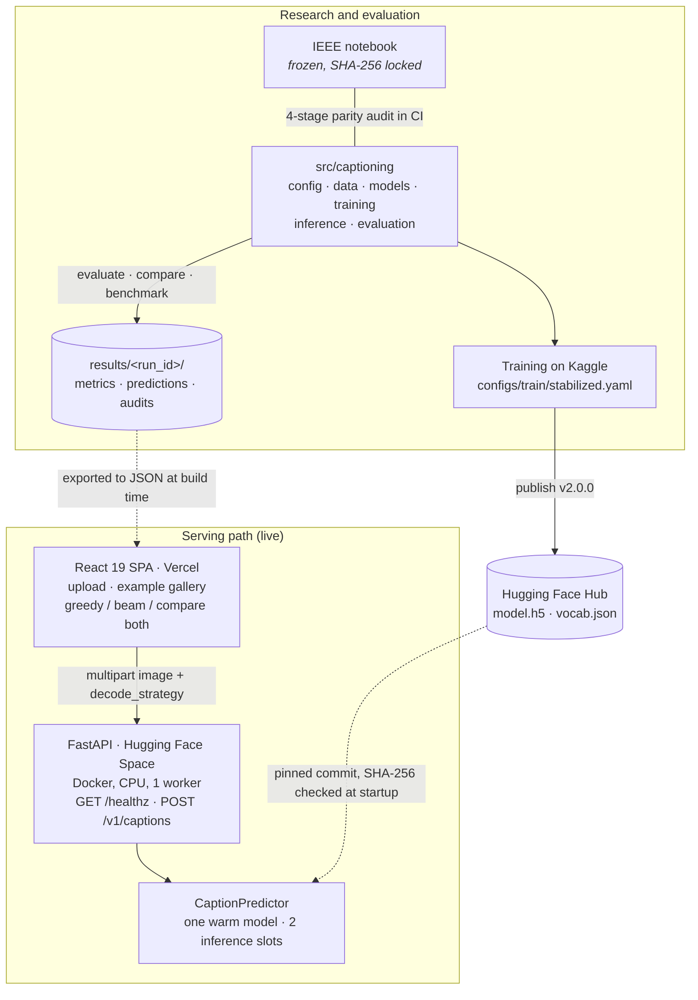

<h1 align="center">Caption Studio</h1>

<p align="center">
  <strong>Upload a photo and get an English caption. The InceptionV3 + Transformer model from an IEEE paper, rebuilt from a research notebook into a tested, deployed full-stack system.</strong>
</p>

<p align="center">
  <a href="https://github.com/apoorvrajdev/image-captioning-system/actions/workflows/ci.yml"></a>
  
  
  
  
  
  <a href="https://doi.org/10.1109/ICSPCRE62303.2024.10675203"></a>
  <a href="LICENSE"></a>
</p>

<p align="center">
  <a href="https://image-captioning-system.vercel.app"><strong>Live app</strong></a> ·
  <a href="#-product-demo">Demo video</a> ·
  <a href="https://apoorvrajdev-image-captioning-api.hf.space/docs">API docs</a> ·
  <a href="#architecture">Architecture</a> ·
  <a href="docs/EVAL_METHODOLOGY.md">Evaluation methodology</a> ·
  <a href="https://doi.org/10.1109/ICSPCRE62303.2024.10675203">Paper</a>
</p>

## 🎬 Product Demo

A short technical demo of the Image Captioning System's live image captioning, model inference pipeline and research-to-production checks.


https://github.com/user-attachments/assets/7d63c76a-019f-4616-a219-fa4043f0233c


**▶ [Watch the 27-second demo]** · [Try the live app](https://image-captioning-system.vercel.app) · [How the demo was made](docs/demo/README.md)

**No photo to hand?** Under **Try an example**, the live app offers five licensed COCO images (CC BY 2.0, credited in the app) that go through the same validation and API call as an upload. Pick **Greedy** or **Beam search** before captioning, or press **Compare both** to run the two decoders on the same image one after the other, each with its measured latency. A **Dataset reference** card shows the caption a person wrote for that image in COCO.

---

Caption Studio describes an image in one sentence. A frozen InceptionV3 network turns the photo into a grid of visual features, and a Transformer decoder writes the caption word by word, either greedily or with beam search. The architecture comes from the IEEE paper *AI Narratives: Bridging Visual Content and Linguistic Expression* and its research notebook, which this repository keeps frozen. Around it sits what it takes for other people to use and maintain that model: an installable Python package, a FastAPI service on Hugging Face Spaces, a React app on Vercel, and CI that gates every deploy.

The part worth reading first is the evaluation. With beam search, the deployed checkpoint scored BLEU-4 10.4 against the paper's ~24, and the obvious move was to retrain. A pre-registered, blinded audit showed the gap came mostly from how many reference captions each image is scored against: rescored against all five COCO references, the same captions reach 25.9. The audit also found the real weakness, which is that captions are fluent but often generic. Both findings are [reported below](#what-the-evaluation-taught-me), next to a comparison with three modern captioning models that is caveated rather than ranked.

## At a glance

| | |
|---|---|
| **Product** | React 19 app on Vercel → FastAPI on a Hugging Face Space (Docker, CPU) → one TensorFlow model loaded at startup. Upload a photo or pick an example; choose greedy or beam search, or compare both |
| **Model** | Frozen InceptionV3 (ImageNet) → 1-layer Transformer encoder → 1-layer, 8-head Transformer decoder, 15,000-token vocabulary, trained on a 120,000-caption COCO 2017 sample. Served as `v2.0.0` from a commit-pinned, SHA-256-verified Hugging Face Hub revision |
| **Caption quality** | CIDEr **0.789** greedy / **0.826** beam on 500 held-out COCO images with ~1.46 references each. BLEU-4 **25.9** when the beam captions are rescored against all 5 COCO references. A blinded review found 3 of 30 captions image-specific and correct |
| **Live latency** | About 0.8–1.0 s (greedy) and 1.4–1.5 s (beam) of model inference per caption on the Space's CPU, about 3 s end to end including the upload. A handful of live requests, not a load test |
| **Software checks** | 563 pytest tests and 27 Playwright browser tests, plus ruff, mypy, a 4-stage notebook parity audit, a SHA-256 notebook freeze, and dependency and secret scans. All of them block CI |
| **Delivery** | A green push to `main` rebuilds the Space only if the image changed. A deploy passes only after the health check and one real caption from the live model |

**Contents:** [What I built](#what-i-built) · [Architecture](#architecture) · [Evaluation](#evaluation) · [Engineering highlights](#engineering-highlights) · [Limitations](#limitations) · [Tech stack](#tech-stack) · [Run locally](#run-locally) · [Testing and CI](#testing-and-ci) · [Repository layout](#repository-layout) · [Roadmap](#roadmap) · [Documentation](#documentation) · [Publication](#publication-and-acknowledgements)

---

## What I built

The paper defined the architecture and its notebook trained the original model. The rest was built in this repository:

- **A web app** ([`frontend/`](frontend/)). React 19, Vite 8 and Tailwind v4: drag-and-drop upload with client-side type and size checks, the example gallery, the Greedy / Beam search / Compare both controls, a live API health badge, and a static **Phase 3 comparison** view of the baseline results.
- **An inference API** ([`backend/app/`](backend/app/)). FastAPI with a Pydantic schema for every request and response, one warm model per process, TensorFlow work moved off the event loop, bounded admission, and a status-code contract shared with the frontend.
- **A modular ML package** ([`src/captioning/`](src/captioning/)). The notebook split into config, preprocessing, data, models, training, greedy and beam-search inference, and evaluation, with a parity audit that proves the split didn't change behaviour.
- **A retrained checkpoint.** The stabilized recipe (label smoothing, warmup into cosine decay), trained on COCO 2017 on Kaggle and published to the Hub as `v2.0.0`. This is what the live app serves.
- **Evaluation tooling.** BLEU-1–4, METEOR, ROUGE-L and CIDEr on a fixed slice, one machine-readable artefact set per run, and a harness that compares the model with BLIP, ViT-GPT2 and GIT under a protocol committed before any result.
- **Delivery.** A Docker image on Hugging Face Spaces, Vercel for the frontend, and GitHub Actions for CI, security scanning and gated deploys.

## Architecture



The two halves meet in two places: the Hub weights the API downloads at startup, and the results JSON the SPA bundles at build time. The serving image contains no notebook, no training data and no evaluation results. The notebook is the published research artefact and stays byte-for-byte as it was; every improvement goes into the package, behind the parity audit.

### Inference pipeline

```text
POST /v1/captions   multipart: image, optional decode_strategy
   → body cap                 413 before a body over 10 MiB (+64 KiB framing) is buffered
   → decode_strategy          greedy (default) or beam, otherwise 422
   → content-type allow-list  JPEG · PNG · BMP, otherwise 415 (WebP and GIF included)
   → bounded read             400 if empty, 413 if over 10 MiB
   → admission                503 + Retry-After: 2 while both inference slots are busy
   → header check + decode    413 over 16,384 px a side or 40 MP, before TensorFlow decodes; 422 if undecodable
   → preprocess_image_tensor  299×299, InceptionV3 scaling: the same function training uses
   → InceptionV3 (frozen)     8×8×2048 feature map → 64 image tokens
   → Transformer encoder      1 layer, 1 head, 512-dim
   → Transformer decoder      1 layer, 8 heads; greedy, or beam search (width 4)
   → CaptionResponse          caption · model_version · decode_strategy · latency_ms · request_id
```

Beam search runs with exactly the settings of the evaluated beam run: width 4, length penalty 0.7, repetition penalty 1.2, no repeated trigrams. A live beam caption is therefore the decoder the metrics below describe.

| Endpoint | Behaviour |
|---|---|
| [`GET /healthz`](https://apoorvrajdev-image-captioning-api.hf.space/healthz) | Always 200; `model_loaded` and `model_version` report readiness. Runs on the event loop, so it never waits behind inference |
| `POST /v1/captions` | Image in, `CaptionResponse` out. Status codes 200 / 400 / 413 / 415 / 422 / 503, each covered by a backend test and consumed by [`frontend/src/services/api.js`](frontend/src/services/api.js) |
| [`GET /docs`](https://apoorvrajdev-image-captioning-api.hf.space/docs) | Swagger UI generated from the Pydantic schemas |

**Where it runs.** The SPA is on [Vercel](https://image-captioning-system.vercel.app), rebuilt on every push to `main`. The API is a [Hugging Face Space](https://huggingface.co/spaces/apoorvrajdev/image-captioning-api): Docker, `python:3.11-slim`, a non-root user, one uvicorn worker on a CPU instance. The weights are in the Hub repo [`apoorvrajdev/captioning-inceptionv3-transformer`](https://huggingface.co/apoorvrajdev/captioning-inceptionv3-transformer) at tag `v2.0.0`, which the backend resolves to commit `59d93b4`. Topology, promotion and rollback are in the [deployment runbook](docs/PHASE_2C_DEPLOYMENT_RUNBOOK.md).

## Evaluation

Every number in this section comes from a committed run directory under [`results/`](results/). The evaluation slice is 500 COCO 2017 `train2017` images from the model's own image-level validation split, so the model never trained on them. They are scored against the 732 reference captions stored with them, about 1.46 per image. That is fewer than the standard five per image, which lowers BLEU in particular; [the audit below](#what-the-evaluation-taught-me) measures by how much.

### Caption quality

| Decoding | BLEU-1 | BLEU-4 | METEOR | ROUGE-L | CIDEr |
|---|---|---|---|---|---|
| Greedy ([run](results/stabilized-greedy/)) | 42.20 | 10.57 | 15.45 | 37.57 | 0.789 |
| Beam search, width 4 ([run](results/stabilized-beam-w4-lp07-rp12/)) | 41.93 | 10.39 | 15.56 | 36.84 | **0.826** |

Beam search gives slightly less n-gram overlap but about 5% more CIDEr, the metric that rewards image-specific wording over generic phrases. That is why the app lets you choose. BLEU-2 and BLEU-3, predictions and per-sample diagnostics are in each run directory.

The served checkpoint used the stabilized recipe ([`configs/train/stabilized.yaml`](configs/train/stabilized.yaml)): the notebook's architecture and hyperparameters, plus label smoothing 0.1, a 500-step warmup into cosine decay, and dropout off during validation. It trained on 120,000 COCO 2017 captions, split 80/20 by image, for 10 epochs at batch 64. Training loss fell from 4.69 to 3.33, and validation accuracy rose every epoch, from 0.429 to 0.475 ([`history.json`](results/history.json)).

### Sample captions

These are the five example images in the live app, with the served `v2.0.0` checkpoint's captions from the committed evaluation runs. The kitten captions are the ones the deployed app returned in the [demo recording](docs/demo/README.md).

| Image | Greedy | Beam search | COCO reference (written by a person) |
|---|---|---|---|
|  | a cat is sitting on a keyboard of a computer | a close up of a cat laying on a keyboard | A kitten sitting on the keyboard of a computer. |
|  | a red fire hydrant sitting on a sidewalk | a red fire hydrant sitting on the side of a road | A red fire hydrant sitting on the side of a road. |
|  | a living room with a couch and a tv | a living room filled with furniture and a flat screen tv | a small living room with a blue couch, flat screen television and a fireplace |
|  | a large airplane flying through the sky | an airplane is flying in the sky on a cloudy day | An airplane flying through a blue sky with propellers. |
|  | a plate of fruit and a salad with a fork | a close up of a plate of food on a table | A collection of fruits are stacked on a plate. |

Neither decoder wins every image. Beam search matches the reference wording on the hydrant and adds the flat-screen TV in the living room, but it calls a clear blue sky cloudy and is vaguer than greedy on the fruit platter.

<sub>Images: COCO 2017 via Flickr, <a href="https://creativecommons.org/licenses/by/2.0/">CC BY 2.0</a>: <a href="https://www.flickr.com/photos/slava/496607907/">“Mango HaX0ring”</a> by Slava · <a href="https://www.flickr.com/photos/pa1nt/2707331770/">“07252008”</a> by pa1nt · <a href="https://www.flickr.com/photos/amy_elizabeth_west/5067711955/">“Living room w/painted cable covers”</a> by Amy West · <a href="https://www.flickr.com/photos/39551170@N02/6815669873/">“US Coast Guard Herc”</a> by Simon_sees · <a href="https://www.flickr.com/photos/little_yiye/3742500176/">“fruit platter”</a> by &gt;littleyiye&lt;. Reference captions: COCO Consortium, <a href="https://creativecommons.org/licenses/by/4.0/">CC BY 4.0</a>.</sub>

### What the evaluation taught me

**Before retraining a model to close a gap, check whether the gap is real.**

The beam checkpoint's BLEU-4 of 10.39 looked about 14 points behind the ~24 the paper reports. Instead of spending GPU hours on a retrain, I ran a pre-registered, blinded audit ([`EVAL_METHODOLOGY.md`](docs/EVAL_METHODOLOGY.md) §§ 1–7). The hypotheses and decision thresholds were committed before any result, and the qualitative review was judged before the BLEU result was unblinded.

| The same 500 beam captions, scored against | References per image | BLEU-4 |
|---|---|---|
| The references stored with the slice | ~1.46 | 10.39 |
| All COCO references for those images | 5 | **25.91** |

BLEU credits an n-gram that matches *any* reference, so the reference count alone moved the headline number by 15 points. Scored on the paper's footing, the checkpoint lands in the same range as the paper. That is **methodology parity, not a claim of beating the paper**. The audit also measured a smaller effect from BLEU smoothing and aggregation: NLTK's variants score the same captions 22.2–23.8 ([`metrics_5ref.json`](results/stabilized-beam-w4-lp07-rp12/metrics_5ref.json)).

The blinded review of 30 beam captions found the real weakness:

| Category | Captions |
|---|---|
| Specific and correct: the right subject plus a distinguishing detail | 3 |
| Correct but generic ("a person on a beach") | 11 |
| Partly correct: a count, colour, action or secondary object wrong | 15 |
| Incorrect | 1 |

Captions are fluent and usually on topic, but mostly generic. With 30 samples, each proportion is uncertain by up to about ±18 percentage points. The verdict was **reframe, do not retrain** ([`verdict.md`](results/stabilized-beam-w4-lp07-rp12/verdict.md)): the BLEU gap was mostly the evaluation setup, and specificity is limited by the frozen ImageNet encoder, which the original training recipe would not change. Retraining on the paper's recipe stays on the [roadmap](#roadmap) as an experiment, not a fix.

### Comparison with BLIP, ViT-GPT2 and GIT

Phase 3 scored three Hugging Face captioning models on the same 500 images and references, at pinned revisions with greedy decoding. The protocol was committed before the first baseline ran ([`EVAL_METHODOLOGY.md`](docs/EVAL_METHODOLOGY.md) § 8).

> **Read this table as context, not a ranking.** The slice is held out for this repository's model only. BLIP's and GIT's model cards state COCO training, and ViT-GPT2 may have used it, so the baselines may have seen these exact images; per-image overlap isn't measured (§ 8.5). With ~1.46 references per image, none of these scores is comparable with published COCO results either.

| Model | Decoding | BLEU-4 | METEOR | ROUGE-L | CIDEr |
|---|---|---|---|---|---|
| BLIP-base | greedy | 19.88 | 17.23 | 42.13 | 1.06 |
| GIT-base-coco | greedy | 18.83 | 21.92 | 47.08 | 1.46 |
| CNN + Transformer (this repo) | beam | 10.39 | 15.56 | 36.84 | 0.83 |
| CNN + Transformer (this repo) | greedy | 10.57 | 15.45 | 37.57 | 0.79 |
| ViT-GPT2 | greedy | 15.84 | 19.78 | 44.51 | 1.26 |

Rows follow [`comparison.md`](results/phase3-comparison/comparison.md), ordered by model id. All three baselines score higher on this slice. Because they may have trained on these images, the table can't say how large that gap is on genuinely unseen images. What it does establish is that the harness reproduces this repository's own results exactly: re-running the greedy row through it gave 500/500 identical captions and bit-identical metrics (§ 8.8).

Latency for all four models, on CPU (a local laptop) and on a Kaggle T4 GPU, is in §§ 9.9–9.10 and in the app's **Phase 3 comparison** view. The two devices were different hosts, so the figures compare models within a device, not CPU against GPU. This model's batch-8 figure is eight sequential calls rather than one batched call.

## Engineering highlights

- **The notebook is frozen, and parity is tested, not assumed.** The paper's notebook stays byte-for-byte as published, locked by a SHA-256 check in CI. A four-stage audit ([`scripts/notebook_module_audit.py`](scripts/notebook_module_audit.py)) re-implements caption preprocessing, tokenisation, image preprocessing and the decoder forward pass from the notebook, and asserts the package matches them. Every later improvement is opt-in behind a flag whose default reproduces the notebook, so a changed number always traces back to one named change.
- **Training and serving share one preprocessing path.** Uploads go through the same `preprocess_image_tensor` that builds the training pipeline, so the model never sees pixels normalised differently in production than in training.
- **Uploads are bounded before they cost anything.** A middleware refuses oversized bodies before the multipart parser buffers them, and the route reads at most one byte past the limit. A header check rejects images over 16,384 px a side or 40 megapixels before TensorFlow decodes them. WebP is refused at the door because TensorFlow 2.15 can't decode it, instead of failing deep inside the model.
- **Inference is bounded too.** The Space runs one CPU worker. At most two captions decode at once, and the next request gets an immediate 503 with `Retry-After: 2` rather than joining a queue that slows everyone down. `/healthz` runs on the event loop, so a busy model never fails the health check.
- **The weights are pinned and verified.** Hub tags can be moved, so the backend resolves `v2.0.0` to a commit id written in reviewed code. It downloads only `model.h5` and `vocab.json` and checks both against SHA-256 digests pinned per commit before anything reads them. The vocabulary loads from validated JSON instead of unpickling a file from the network ([ADR-032, ADR-033](docs/DECISIONS.md)).
- **Decoding is a per-request choice on one model.** Greedy is the default, and beam search uses the evaluated settings. Compare both in the app is two ordinary requests to the same loaded weights, not a second model.
- **Configuration is strict.** Every config model is Pydantic v2 with `extra="forbid"`, so a misspelt hyperparameter fails at load instead of silently falling back to a default. Research settings (`CAPTIONING__*`) and deployment settings (`BACKEND_*`) are separate objects, and environment variables outrank the YAML ([ADR-029](docs/DECISIONS.md)).
- **Only tested commits deploy, and only when needed.** After green CI, the Space rebuilds only if an image input changed since the last successful deploy, and it receives a single-commit snapshot of exactly the tested build context. A deploy passes only once the health check reports the model loaded and one real caption comes back from the live Space ([ADR-027, ADR-028, ADR-030](docs/DECISIONS.md)).
- **Results are artefacts, not prose.** Every evaluation writes a run directory with metrics, predictions and per-sample diagnostics, and run directories are never rewritten. The app's comparison view is exported from those files at build time, and a test fails if the two disagree ([ADR-021](docs/DECISIONS.md)).
- **TensorFlow is pinned at 2.15 on purpose.** TensorFlow 2.16 switches to Keras 3, which breaks `TextVectorization` save and load, and serving depends on that tokenizer round trip. The baselines' `torch` and `transformers` live in an optional `[hf]` extra and are imported lazily, so the serving image never installs them.

## Limitations

### Model

- Captions are often generic, and count, colour and attribute mistakes are common (see the blinded review above, and [`qualitative.jsonl`](results/stabilized-beam-w4-lp07-rp12/qualitative.jsonl) for 30 predictions next to their references). This is a frozen ImageNet CNN with a one-layer decoder, trained for 10 epochs on a 120,000-caption sample: a working demonstration of the paper's model, not a general-purpose captioner.
- It writes English only, in the vocabulary of COCO's everyday scenes. Unusual compositions fall back to generic captions.
- Quality is measured on one 500-image slice with ~1.46 references per image. The 5-reference rescore covers BLEU only.
- The baseline comparison is not held out for the baselines, as explained above.

### System

- It is a public demo with no authentication and no rate limiting. One heavy client can keep both inference slots busy, and everyone else gets the 503 until a slot frees.
- It runs on a CPU and one worker. The first request after an idle period can be slow while the Space wakes up.
- The Hugging Face proxy answers CORS itself and reflects any origin, so the app's allowed-origin list isn't enforced at the edge.
- The frontend has no unit tests. The browser tests run on Chromium only, against a mocked API.

The full list, with risks and suggested fixes, is in [`SECURITY.md`](docs/SECURITY.md) § Known gaps and [`PHASE_1_NOTES.md`](docs/PHASE_1_NOTES.md#technical-debt-remaining).

## Tech stack

| Area | Technologies |
|---|---|
| **Frontend** | React 19, Vite 8, Tailwind CSS v4, ESLint (flat config) |
| **Backend** | FastAPI 0.133, Starlette 1.3, Pydantic v2 and pydantic-settings, Uvicorn, structlog, anyio |
| **ML and inference** | TensorFlow-CPU 2.15 (pinned), NumPy 1.26, Pillow, `huggingface-hub` |
| **Evaluation** | sacrebleu (BLEU), pycocoevalcap (CIDEr, METEOR), rouge-score (ROUGE-L); optional `[hf]` extra with `torch` 2.3.0 and `transformers` 4.41.2 for the baselines |
| **Testing and quality** | pytest, Playwright (Chromium), ruff, mypy, pre-commit (including nbstripout and gitleaks), pip-audit, npm audit |
| **Deployment** | Docker, Hugging Face Spaces and Hub, Vercel, GitHub Actions |

## Run locally

**Prerequisites:** Python 3.10–3.12 (TensorFlow 2.15 has no 3.13 wheels), Node 20.19+ or 22.12+ (the range Vite 8 supports), and Git.

```bash
# Backend: install (on Windows, activate with .venv\Scripts\activate)
python3.10 -m venv .venv && source .venv/bin/activate
pip install -r requirements-dev.txt -r requirements-eval.txt
pip install -e ".[hf,mlflow]"

# Serve the published v2.0.0 weights: downloaded from the Hub on first start, SHA-256-checked before loading
export BACKEND_WEIGHTS_HUB_REPO=apoorvrajdev/captioning-inceptionv3-transformer
export BACKEND_WEIGHTS_HUB_REVISION=v2.0.0
export BACKEND_MODEL_VERSION=v2.0.0
uvicorn app.main:app --app-dir backend --port 8000      # Swagger UI at http://localhost:8000/docs

# Frontend, in a second terminal
cd frontend
npm install
npm run dev                                             # http://localhost:5173
```

The SPA calls `http://127.0.0.1:8000` unless `VITE_API_BASE` is set (see [`frontend/.env.example`](frontend/.env.example)). To caption from the command line:

```bash
curl -F "image=@photo.jpg" -F "decode_strategy=beam" http://localhost:8000/v1/captions
```

Without network access, [`scripts/bootstrap_dev_artifacts.py`](scripts/bootstrap_dev_artifacts.py) writes untrained weights that boot the whole stack; their captions are gibberish by design. Training needs COCO 2017 locally: `python -m scripts.train --config configs/train/stabilized.yaml --output-dir outputs/runs/stabilized`, with the full procedure in the [stabilized training runbook](docs/STABILIZED_TRAINING_RUNBOOK.md). Deployment, weights promotion and rollback are in the [deployment runbook](docs/PHASE_2C_DEPLOYMENT_RUNBOOK.md).

## Testing and CI

| Suite | Command | Tests |
|---|---|---|
| Library and script unit tests | `pytest tests -q` | 446 |
| Backend route tests (fake predictor, no TensorFlow) | `pytest backend/app/tests -q` | 117 |
| Browser E2E (Playwright, Chromium, API mocked) | `cd frontend && npm run test:e2e` | 27 |
| Notebook parity audit | `python -m scripts.notebook_module_audit` | 4 stages |

Every test is CPU-only and offline: no network, no model download. Playwright needs `npx playwright install chromium` once per machine. The exact lint and type-check invocations are in [`docs/CI.md`](docs/CI.md) § Local equivalents.

CI ([`ci.yml`](.github/workflows/ci.yml)) runs on every push and pull request to `main`, and every job blocks:

| Job | Checks |
|---|---|
| Python quality | ruff lint and format check, mypy |
| pytest (Python 3.10 and 3.11) | all 563 tests, then the parity audit |
| Notebook freeze | the notebook's SHA-256 against `.paper-notebook.sha256` |
| pre-commit | every hook on every file |
| Security | pip-audit of `requirements.txt` against a reviewed baseline, gitleaks over the full history |
| Frontend | ESLint, production build, Playwright E2E, `npm audit --omit=dev` |

After a green run on `main`, [`deploy-backend.yml`](.github/workflows/deploy-backend.yml) decides whether the Space image changed, deploys the tested commit if it did, and gates on the health check and a real caption. Vercel deploys the frontend through its Git integration.

## Repository layout

```text
image-captioning-system/
├── notebooks/            # the paper's notebook, frozen (hash in .paper-notebook.sha256)
├── src/captioning/       # installable package
│   ├── config/           #   Pydantic v2 schema, YAML + environment loader
│   ├── preprocessing/    #   caption cleanup, image preprocessing shared by training and serving, tokenizer
│   ├── data/             #   COCO loading, image-level split, tf.data pipeline
│   ├── models/           #   InceptionV3 encoder, Transformer encoder and decoder, model factory
│   ├── training/         #   losses, learning-rate schedule, trainer
│   ├── inference/        #   CaptionPredictor, greedy and beam-search decoders
│   ├── evaluation/       #   metrics, run artefacts, Phase 3 comparison and latency
│   └── baselines/        #   one Captioner interface for this model and the Hugging Face baselines
├── backend/app/          # FastAPI: routes, schemas, services (predictor, weights loader), settings, tests
├── frontend/             # React SPA; src/services/api.js is the only API boundary, e2e/ the Playwright suite
├── configs/              # base.yaml reproduces the notebook; train/stabilized.yaml is the served recipe
├── scripts/              # train, evaluate, predict, compare, benchmark, parity audit, deploy helpers
├── results/              # committed evaluation runs, append-only
├── tests/unit/           # library and script tests
├── docs/                 # methodology, runbooks, decisions, security, task history
├── Dockerfile            # the Hugging Face Space image
└── .github/workflows/    # CI and the gated Space deploy
```

## Roadmap

Phases 0–4 are complete: modularisation behind a parity gate, training stabilisation and the metric suite, the API and web app, public deployment, the baseline comparison, and production hardening. Work since then has hardened the upload path and the weights supply chain and added the example gallery and per-request decoding.

<details>
<summary>Completed phases</summary>

- **Phase 0, bootstrap.** Packaging, pre-commit hooks, the notebook freeze and pinned dependencies.
- **Phase 1, modularisation.** The notebook split into the `captioning` package behind the four-stage parity audit, with strict typed configuration and unit tests.
- **Phase 1b, training stabilisation.** Beam search, the BLEU / METEOR / ROUGE-L / CIDEr suite with per-run artefacts, the opt-in stabilized recipe and the `v2.0.0` checkpoint, then the Stage 0 evaluation audit (reframe, do not retrain).
- **Phase 2, serving and deployment.** The FastAPI service (2A), the React SPA (2B), and public deployment on Hugging Face Spaces and Vercel with CI/CD (2C).
- **Phase 3, multimodal baselines.** The pre-registered comparison with BLIP, ViT-GPT2 and GIT, CPU and GPU latency, the static comparison view, and Playwright E2E.
- **Phase 4, production hardening.** A pinned CI platform, upgraded serving dependencies, dependency and secret scanning, deploys only when the image changes, and the post-deploy caption check.
- **Since Phase 4.** Environment variables that outrank the YAML, single-commit Space snapshots, pre-decode pixel limits, bounded inference admission, commit-pinned and SHA-256-verified weights, the example gallery, and per-request greedy or beam decoding with Compare both.

Task-by-task history, with the verification behind each task: [`docs/TASKS.md`](docs/TASKS.md).

</details>

**Possible next steps.** These are directions, not current capabilities:

- **Original-recipe ablation.** Retrain with the paper's recipe (constant Adam, no label smoothing, early stopping) under the same evaluation, to find out whether it beats the stabilized recipe on this architecture.
- **A stronger encoder.** Specificity is limited by the frozen InceptionV3. Fine-tuning a modern vision-language captioner such as BLIP-2 on COCO, under the same protocol, would show what better captions cost per request.
- **Streaming captions.** Server-sent events from `/v1/captions`, so the app shows words as the decoder produces them.
- **Batch captioning.** One request for a list of images, to amortise per-request overhead.
- **Visual question answering.** A `POST /v1/vqa` route that reuses the warm encoder.
- **Online evaluation.** Score each new checkpoint on a held-out slice automatically and publish quality and latency over time.

## Documentation

| Document | What it covers |
|---|---|
| [`docs/EVAL_METHODOLOGY.md`](docs/EVAL_METHODOLOGY.md) | The Stage 0 audit (§§ 1–7), the Phase 3 comparison protocol and results (§ 8), and the latency protocol and results (§ 9) |
| [`docs/PHASE_2C_DEPLOYMENT_RUNBOOK.md`](docs/PHASE_2C_DEPLOYMENT_RUNBOOK.md) | Deployment topology, Space and Vercel setup, weights promotion and rollback |
| [`docs/CI.md`](docs/CI.md) | Every CI and deploy job, and their local equivalents |
| [`docs/SECURITY.md`](docs/SECURITY.md) | Controls in place, known gaps, the dependency audit and the CI scanning policy |
| [`docs/DECISIONS.md`](docs/DECISIONS.md) | Architecture decision records |
| [`docs/TEST_PLAN.md`](docs/TEST_PLAN.md) | The checks each kind of change must pass |
| [`docs/STABILIZED_TRAINING_RUNBOOK.md`](docs/STABILIZED_TRAINING_RUNBOOK.md) | How the stabilized checkpoint was trained |
| [`docs/TASKS.md`](docs/TASKS.md) · [`docs/MEMORY.md`](docs/MEMORY.md) | Task history with verification records · current project state |
| [`notebooks/README.md`](notebooks/README.md) | The frozen-notebook policy |
| [`docs/demo/README.md`](docs/demo/README.md) | How the demo video was made, what in it is real, and its credits |
| [`docs/PHASE_0_NOTES.md`](docs/PHASE_0_NOTES.md) · [`docs/PHASE_1_NOTES.md`](docs/PHASE_1_NOTES.md) · [`docs/restructure-plan.md`](docs/restructure-plan.md) | Early phase notes and the original restructure plan |

## Publication and acknowledgements

The model architecture and the original notebook come from:

> Preetam, S. C. Muppalla, A. Raj and J. Chawla, "AI Narratives: Bridging Visual Content and Linguistic Expression," *2024 IEEE International Conference on Smart Power Control and Renewable Energy (ICSPCRE)*, 2024. doi: [10.1109/ICSPCRE62303.2024.10675203](https://doi.org/10.1109/ICSPCRE62303.2024.10675203) · [IEEE Xplore](https://ieeexplore.ieee.org/document/10675203)

The notebook is kept verbatim at [`notebooks/01_ieee_inceptionv3_transformer.ipynb`](notebooks/01_ieee_inceptionv3_transformer.ipynb). Improvements go into `src/captioning/`, never into the notebook.

- **[COCO 2017](https://cocodataset.org/)** provides the training and evaluation data. The annotations are CC BY 4.0, and each image keeps its own Flickr licence.
- **InceptionV3** ImageNet weights come from Keras Applications.
- **BLIP-base** (Salesforce), **ViT-GPT2** (nlpconnect) and **GIT-base-coco** (Microsoft), from the Hugging Face Hub, are used for evaluation only and are never served.
- The demo video's music, sound effects and typefaces are credited in [`docs/demo/README.md`](docs/demo/README.md#credits).

## License

Released under the [MIT License](LICENSE). Built by [apoorvrajdev](https://github.com/apoorvrajdev) · [apoorvrajmgr@gmail.com](mailto:apoorvrajmgr@gmail.com)
